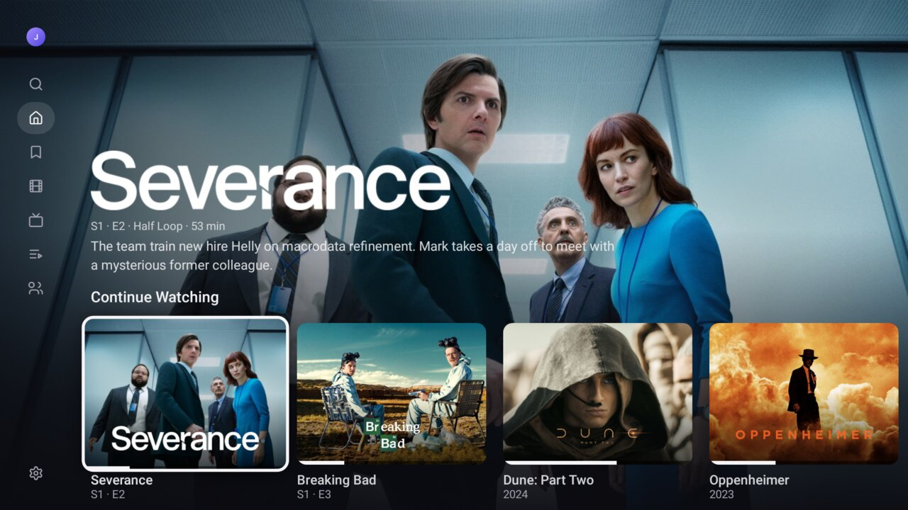
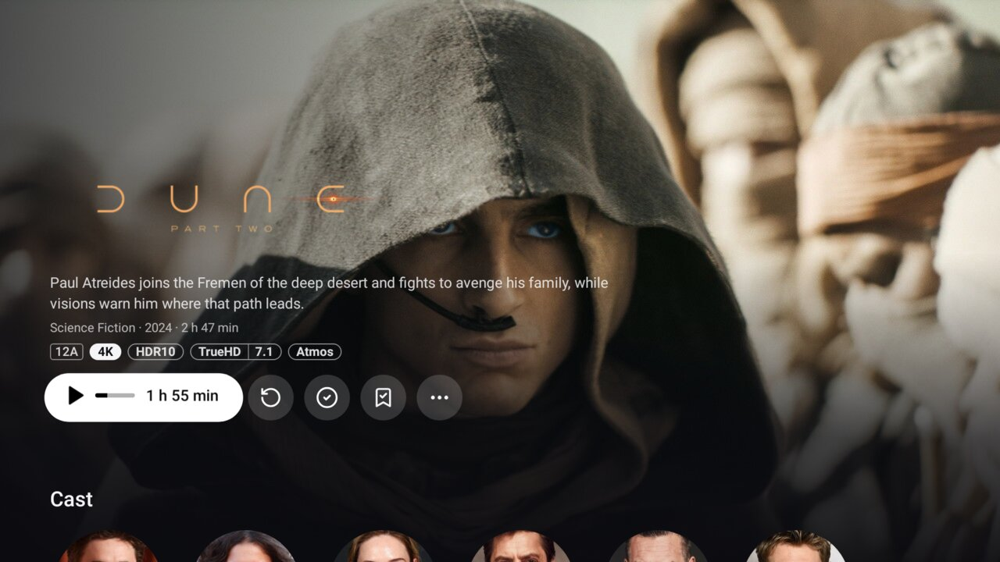
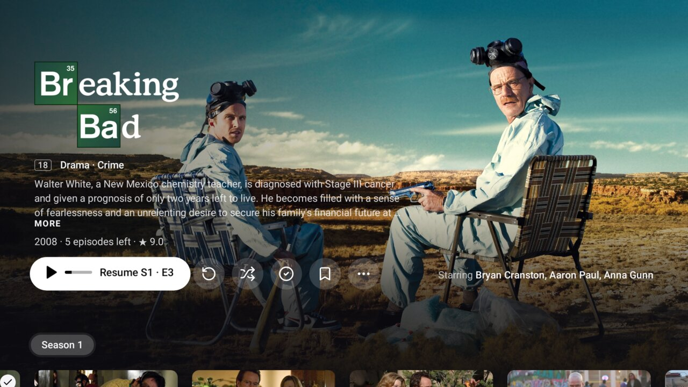
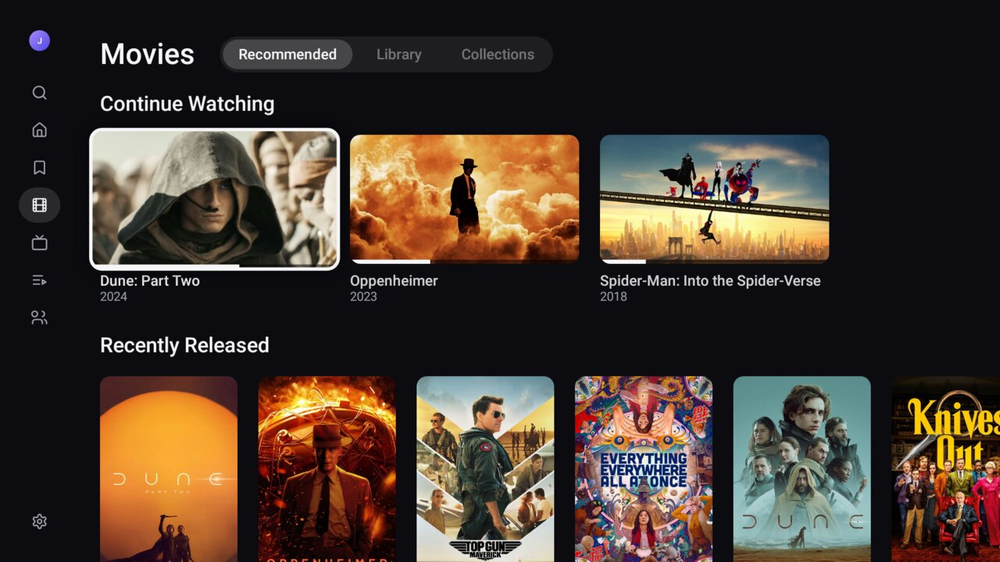
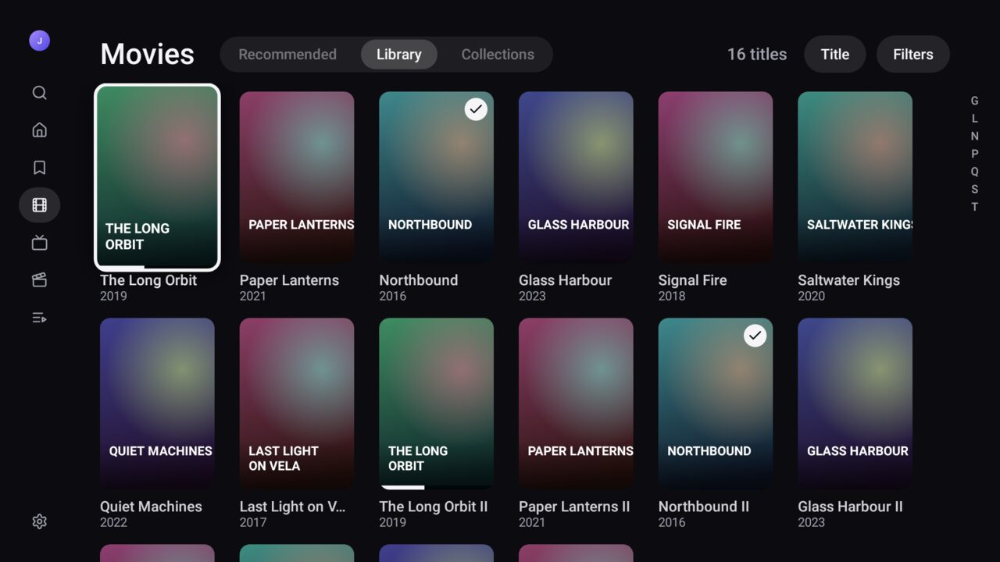
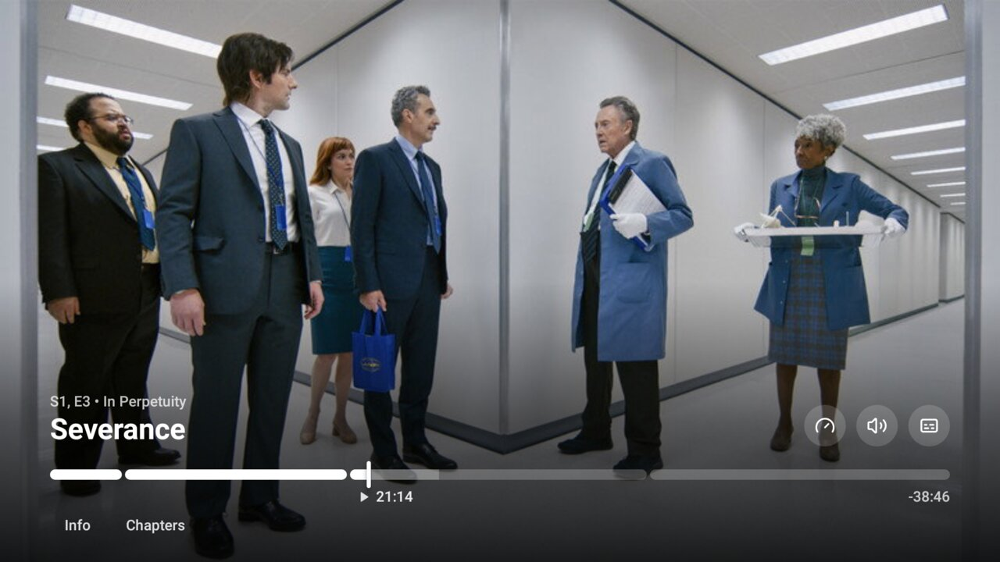
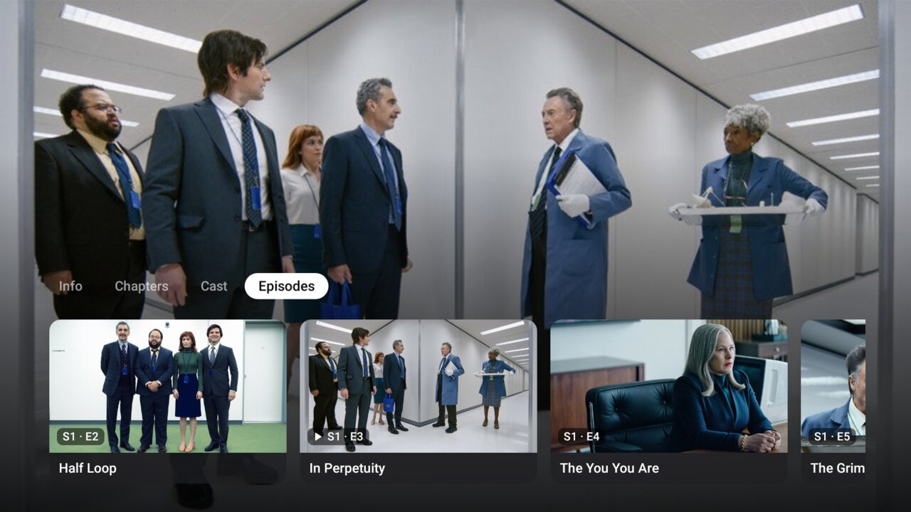
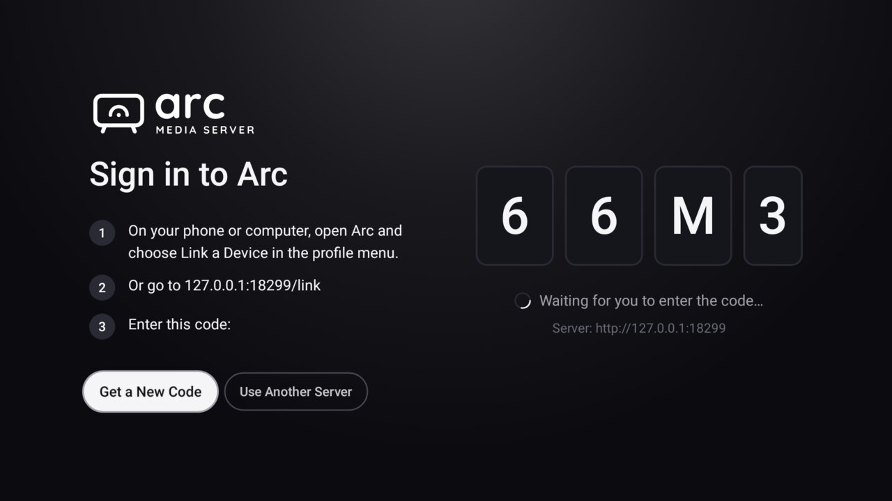
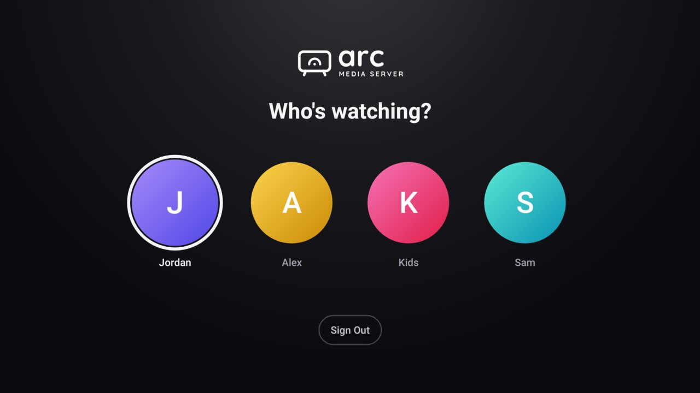
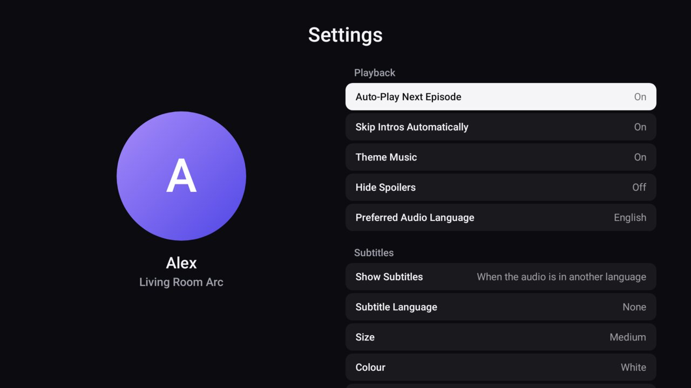

<p align="center">
  <picture>
    <source media="(prefers-color-scheme: dark)" srcset="docs/brand/arc-logo-stacked-white.svg">
    
  </picture>
</p>

<p align="center">
  <strong>Arc for Android TV: your Arc library on Google TV, made for the remote.</strong>
</p>

<p align="center">
  
  
  
  
  
</p>

<p align="center">
  
</p>

## What is Arc for Android TV?

The Android TV and Google TV app for
[Arc Media Server](https://github.com/arc-media-server/arc-media-server). It's a native app
(Kotlin, Jetpack Compose for TV and Media3) that feels at home on Google TV: standard focus, Back
always works, and your Arc artwork fills the screen.

Everything comes from your Arc server through its stable `/api/v1`, so your watch history, resume
points and settings are the same as on every other Arc app. A phone and tablet interface will
follow in this same app.

> **Alpha software.** It's in daily use, but not yet checked on every TV. Playback, HDR, Dolby
> Vision and passthrough depend on your TV, streaming box and receiver. See
> [what's changed](docs/changes/).

<table>
  <tr>
    <td width="50%"></td>
    <td width="50%"></td>
  </tr>
  <tr>
    <td width="50%"></td>
    <td width="50%"></td>
  </tr>
  <tr>
    <td width="50%"></td>
    <td width="50%"></td>
  </tr>
</table>

## What it does

**🏠 Artwork-led Home.** Continue Watching, Up Next and your libraries' rows, laid out as you
arranged them in Arc, with the focused title's artwork filling the screen as you move.

**🎬 Title pages in Arc's design.** Play or Resume, Watched and Watchlist; cast, extras,
related titles and collections; seasons and episodes in the order you chose in Arc, including
episodes that order doesn't place. Mark a whole season watched or unwatched. Pick a version (4K,
a Director's Cut) when a title has more than one.

**📚 Libraries you can browse.** Recommended rows, a Library grid with Sort, Filters and an A–Z
bar, Collections and folders for home videos, Play All and Shuffle, playlists, and pages for
people and collections. Search finds titles, people, collections and genres.

**▶️ A full player.** Media3 plays the original file whenever the TV can, and Arc converts only
what it can't. The controls match Arc's other players: the timeline with thumbnails and chapters,
Skip Intro, Recap and Credits, Up Next, audio and subtitle tracks (including styled ASS subtitles),
quality and versions, the episode list and Stats for Nerds. Your progress goes to Arc as you watch.

**🔊 Your home cinema.** The app tells Arc what your TV and receiver take, including HDR formats,
Dolby Vision profiles, Dolby Atmos and DTS-HD/DTS:X passthrough, so files play as they are where
possible.

**📺 Part of Google TV.** Continue Watching appears in Google TV's own "Continue watching" row on
the home screen, and choosing a title there resumes it in Arc.

**👨‍👩‍👧 Made for a household.** Profiles with PINs, Hide Spoilers, Auto-Play, Skip Intros and
audio and subtitle preferences that follow you to every Arc app.

**🔐 Signs in with a code.** Enter your server's address, then approve a short code from Arc on
your phone or computer. The sign-in is kept encrypted with Android's Keystore, and appears in
Arc's Settings → Devices, where it can be signed out.

<table>
  <tr>
    <td width="33%"></td>
    <td width="33%"></td>
    <td width="33%"></td>
  </tr>
</table>

## Installing

You need an Android TV or Google TV device (Android 8.0 or newer) and an Arc server you can reach
from it. The app isn't in the Play Store yet, so it's installed from an APK.

1. **Get the APK.** Build it yourself (see *For developers* below), or download one from this
   repository's **Actions → Build** runs (Summary → Artifacts).
2. **Turn on developer options on the TV:** Settings → Device Preferences → About, press OK on
   **Build** seven times, then in Developer options turn on **USB debugging** or **Network
   debugging**. Note the TV's IP address (Settings → Network).
3. **Install it from a computer on the same network:**
   ```sh
   adb connect <tv-ip>:5555        # accept the prompt on the TV the first time
   adb install -r arc.apk
   ```
   Or sideload the APK with an app such as *Send Files to TV* or *Downloader*.
4. **Open Arc** from the TV's apps. Enter your server's address, as you'd type it in a browser at
   home (port 8099 is assumed unless you type another; `https://arc.example.com` works for remote
   access). Then open Arc on your phone or computer, choose **Link a Device** in the profile menu
   (or go to `<server>/link`) and enter the code shown.

## For developers

You need JDK 21 and the Android SDK (platform 37, platform-tools). Then:

```sh
./gradlew assembleDebug          # app/build/outputs/apk/debug/app-debug.apk
./gradlew testDebugUnitTest      # unit tests (and the screenshot tests, without saving images)
./gradlew recordRoborazziDebug   # renders every screen at 1920x1080 into app/screenshots/
```

`recordRoborazziDebug` renders the screens on the JVM (Robolectric), so no emulator is needed;
look at them after changing the UI. The pictures in this README come from it. The screens show
real films and a show; their artwork comes from TMDB and isn't kept in git. Download it once with
`TMDB_API_KEY=<your key> python3 tools/fetch-screenshot-art.py` (it lands in
`app/src/test/resources/artwork/`, which git ignores); without it, the screens show drawn
stand-ins, which is fine for checking a layout.

### Setting up the SDK

- **Windows:** install Android Studio (`winget install Google.AndroidStudio`), open this
  repository and let it install the SDK it asks for; or, without the IDE, download the "command
  line tools only" zip from developer.android.com, unzip it to
  `%LOCALAPPDATA%\Android\Sdk\cmdline-tools\latest`, and run
  `sdkmanager "platform-tools" "platforms;android-37.0" "build-tools;36.0.0"`. Set `ANDROID_HOME`
  to the SDK folder (or put `sdk.dir=...` in `local.properties`), then use `gradlew.bat`.
- **Linux:** `tools/setup-sdk.sh [sdk-dir]` installs the command-line tools and the same packages;
  then `export ANDROID_HOME=<sdk-dir>`.

### Builds on GitHub and signing

GitHub builds the APK on request: Actions → Build → Run workflow (any branch), or push a commit
whose message contains `[build]`. It never runs otherwise, to save Actions minutes. It runs the
unit tests, builds the release APK with the run number as its version code, and attaches
`arc-android-<run>` to the run (Summary → Artifacts).

Release builds are signed with Arc's own key when `ARC_KEYSTORE_FILE`, `ARC_KEYSTORE_PASSWORD`,
`ARC_KEY_ALIAS` and `ARC_KEY_PASSWORD` are set (on GitHub: the `ARC_KEYSTORE_BASE64`,
`ARC_KEYSTORE_PASSWORD`, `ARC_KEY_ALIAS` and `ARC_KEY_PASSWORD` secrets), and with a throwaway key
otherwise. There are no signing keys in git. An app only installs over an earlier one signed with
the same key, so with a throwaway key, uninstall the old build first (and sign in again).

### Testing against a real Arc

`LiveServerTest` drives the API client through a whole visit against a running Arc: TV sign-in
code, a wrong and a right PIN, Home rows, a library, a show's seasons, a direct-play decision with
a ranged read of the file, a converted HLS stream, progress, the keep-alive ping and the session's
end, and picture subtitles burned in when a film has them. It's skipped unless pointed at a server.
Use a scratch Arc, never a real one:

```sh
# in the arc-media-server repository
cd web && npm install && npm run build && cd ..
go build -o /tmp/ams ./cmd/ams
go run ./tools/testmedia -out /tmp/arc-tv-media
# a film with PGS subtitles for the burn-in check (from this repository; needs ffmpeg and Pillow)
python3 tools/pgs-test-film.py "/tmp/arc-tv-media/Movies/Arrival (2016)/Arrival (2016).mkv"
AMS_LISTEN=127.0.0.1:8199 /tmp/ams -data /tmp/arc-tv-data -config none &
# set it up: an admin with a password, the test library, and a profile "Sam" with PIN 2468
curl -c /tmp/j -b /tmp/j -X POST localhost:8199/api/auth/setup -d '{"name":"Admin","password":"test-pass-123"}'
curl -b /tmp/j -X POST localhost:8199/api/libraries -d '{"name":"Movies","kind":"movies","paths":["/tmp/arc-tv-media/Movies"]}'
curl -b /tmp/j -X POST localhost:8199/api/libraries -d '{"name":"TV","kind":"shows","paths":["/tmp/arc-tv-media/TV"]}'
curl -b /tmp/j -X POST localhost:8199/api/profiles -d '{"name":"Sam","color":"teal","pin":"2468"}'
# then, in this repository
ARC_E2E_URL=http://127.0.0.1:8199 ARC_E2E_PASSWORD=test-pass-123 \
  ./gradlew testDebugUnitTest --tests '*LiveServerTest*' --rerun -i | grep E2E:
```

### Layout

```
app/src/main/java/org/arcmediaserver/android/
  ArcApplication.kt, AppContainer.kt   app-wide objects (session, HTTP clients, image loader, caps)
  data/        ArcApi (the /api/v1 client), Models, ServerAddress, SessionStore (Keystore-encrypted
               token), HomeRows (the profile's Home layout, resolved as the web app does), ArcLog
  playback/    DeviceCapabilities (what this device plays), PlaybackClock (offset_ms, seeks, subtitles)
  ui/          one package per screen: launch, server, signin, profiles, browse (Home, libraries,
               sidebar), details (movies, episodes, a show's seasons), player; components and theme
app/src/main/res/values/strings.xml    every word the app shows
app/src/test/                          unit tests, screenshot tests, and the live end-to-end test
```

`adb logcat -s Arc` shows what the app logs. Each change is described in
[`docs/changes/`](docs/changes/).

## Licence

AGPL-3.0-only, copyright "The Arc Media Server Authors". See [LICENSE](LICENSE).

The film and TV artwork in the screenshots belongs to its owners and comes from
[TMDB](https://www.themoviedb.org). This product uses the TMDB API but is not endorsed or
certified by TMDB.
